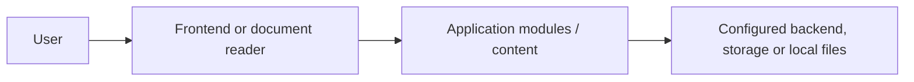

# Comparative Religion — PDF document library

> **Verification status:** Documentation derived from inspected repository files. Application execution and screenshots have not yet been verified.

## Purpose and features

A categorized PDF library under `library/` and a catalog-related `pdf names.json` file.

## Architecture

This diagram is conceptual, not a claim about a deployed system. Refer to the repository directories above for the actual source.

## Installation and running

No server needed. Clone and browse the subject directories with a local PDF reader.

Install required runtimes and dependencies, inspect package manifests, and provide secrets through local ignored configuration. These commands are **not yet runtime-tested**.

## Screenshots and walkthrough

No verified runtime screenshots have been captured. Once the application runs with sanitized demo data, capture each screen into `docs/screenshots/`, document its purpose and workflow, and record the run command and commit. Do not use synthetic screenshots as evidence of running code.

## Security and maintenance

Check redistribution rights, source attribution and licenses for every PDF.

Run dependency checks, verify licenses and inspect configuration before deployment. Do not include real credentials or private data in screenshots.

## Contributing and review

Use feature branches and pull requests. Document reproduction steps, expected behavior, test results and any known limitations. Do not merge documentation until its setup commands and links have been checked.

## Checklist

- [x] Purpose and code-grounded structure
- [x] Initial run instructions and security notes
- [ ] Verify full local startup and workflows
- [ ] Capture real, sanitized screenshots
- [ ] Review deployment readiness

See [documentation audit](docs/PORTFOLIO_AUDIT.md) for the detailed plan.
